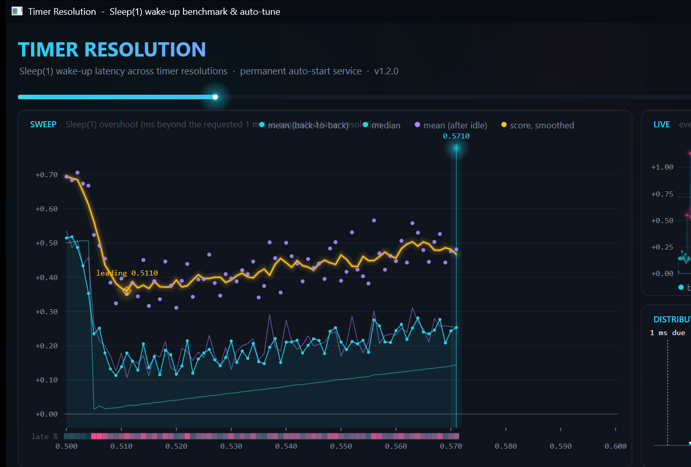

# Synchronus

Software of **Lucius & Wayne Systems** — [luciuswayne.com](https://luciuswayne.com)

One self-contained executable that finds the timer resolution your system
actually responds fastest at, then installs a Windows service so that
resolution is held permanently from every boot, then walks CPU, GPU, memory,
and storage latency tweaks as named steps. No installer, no runtime,
no dependencies — and the same binary is the benchmark, the installer and
the service.

See [Fixing timing precision in Windows after "The Great Rule Change"](https://github.com/valleyofdoom/PC-Tuning/blob/main/docs/research.md#fixing-timing-precision-in-windows-after-the-great-rule-change)
for why a process must request a resolution at all, and
[Micro-adjusting timer resolution for higher precision](https://github.com/valleyofdoom/PC-Tuning/blob/main/docs/research.md#micro-adjusting-timer-resolution-for-higher-precision)
for why the fastest setting is often *not* the kernel minimum (0.5 ms):
on the test machine used while writing this, 0.56 ms produced a median
`Sleep(1)` overshoot of +0.12 ms against +0.50 ms at 0.50 ms.

## Just run it

```
Synchronus.exe
```



Double-click it. A Direct2D window opens and the benchmark starts immediately:
the sweep curve, a live oscilloscope of every `Sleep(1)` wake-up, the
distribution against the clock ticks, and per-candidate statistics all
update as samples land. When verification picks a winner, **Install & hold
at every boot** copies the exe to `%ProgramFiles%\Synchronus\`, sets
`GlobalTimerResolutionRequests=1` (system-wide requests on Windows 11 /
Server 2022+; full effect after reboot), and starts the auto-start
`Synchronus` service. UAC is only required for that install step.

Everything is also logged to `%ProgramData%\Synchronus\Synchronus.log`.

The measurement itself: `Sleep(1)` timed with `QueryPerformanceCounter`
across 0.50–0.60 ms in 0.001 ms steps, three interleaved passes, both a
back-to-back loop and an idle-gap pattern, then 10-round verification of
the finalists. Score = winsorised mean + stdev (both patterns); a small
safety margin sits above the measured optimum so load-induced wake-up
latency does not drop you back onto the bimodal 0.5 ms edge.

After the service is installed the app probes whether the CPU frequency is
**static** (BIOS-locked multiplier, or Windows already holding 100% min
processor state) or **dynamic** (turbo / PBO / SpeedStep). On a static
clock, ntoskrnl’s periodic P-state and core-parking DPCs are just noise;
the [PC-Tuning](https://github.com/valleyofdoom/PC-Tuning) PPM tweaks
raise `PERFCHECK` to 5000 ms, disable core parking, pin processor state at
100%, and write the rest of the processor power settings (boost policy,
energy preference, duty cycling, class-1 cores). Hidden power settings are
un-hidden first; every value is written through the power API and
`powercfg` so nothing is silently skipped. Each tweak is explained on
screen and held for a few seconds before it is written.

After PPM the same style of pass applies **GPU driver optimization**:
hardware-accelerated GPU scheduling, Game DVR/overlay off, NVIDIA global
3D (prefer maximum performance, high-performance filtering, VSync force
off, ultra low latency, Resizable BAR, CUDA Force P2 off, Ansel off) and
the AMD Anti-Lag / ULPS set. DDU, NVCleanstall, and the firmware menu still
have to be done by you. The restart screen lists the BIOS items: a locked
multiplier, deep C-states off, XMP or DOCP, and Above 4G if you want ReBAR.

A separate step, which can be run on its own, installs MSI Afterburner and
RivaTuner. The download and the NVIDIA OC scan take about 30 minutes. The
curve is saved as profile 1 and applied at every logon.

The app **requires administrator rights** at launch (UAC). `--uninstall`
restores the previous power-plan and GPU values and removes the tray's
start-with-Windows entry.

Closing the window leaves Synchronus in the system tray. The tray menu can
open the window, run a read-only health check, pause monitoring, turn
notifications on, turn start-with-Windows on, open Settings, or exit. Each tune step runs
on its own worker, so leaving its screen does not stop it. Full tune runs
the selected steps together and asks only before a driver install or
Afterburner. Each running step has a pane, and a new step waits until a pane
is free. Steps that share the clock, the power plan, the disk, or the
graphics driver wait instead of writing at the same time. With automatic
maintenance on, those same monitored settings are read on the interval in
Settings (one minute unless you change it) and a
drifted value is put back. If the same value keeps resetting, a stronger fix
is applied and repeated at startup. The first time the window opens, you can
uncheck starting with Windows minimized to the tray. After that the app
keeps running on its own. Health compares the
live timer, power, graphics, memory, storage, and utility state with what
Synchronus last applied. A saved "applied" flag is not treated as proof.
Repairs call the existing steps and then check again. The background check
defaults to every six hours and does not change the machine. `--health`
prints the same report. `--self-test` checks the status rules only.

## Other modes

```
Synchronus.exe --cli                 same default flow, console instead of GUI
Synchronus.exe --benchmark           console benchmark only, change nothing
Synchronus.exe --install             console benchmark + install
Synchronus.exe --install --resolution 5000
                                          skip the benchmark, pin 0.5 ms
                                          (value is in 100-ns units)
Synchronus.exe --quick               coarse GUI/CLI preview (~20 s)
Synchronus.exe --apply               hold a resolution in this console
                    --resolution 5000     until Ctrl+C; installs nothing
Synchronus.exe --status              service state, configured and
                                          currently reported resolution
Synchronus.exe --start / --stop      control the installed service
Synchronus.exe --uninstall           remove the service, delete the
                                          installed copy, and restore
                                          GlobalTimerResolutionRequests to
                                          whatever it was before install
Synchronus.exe --samples 150         back-to-back samples per candidate
                                          per pass (default 150; half as many
                                          idle-gap samples are added)
Synchronus.exe --apply-ppm           PPM tweaks only (locked-multiplier CPUs)
Synchronus.exe --ppm / --no-ppm      force or skip the PPM step after install
Synchronus.exe --apply-gpu           GPU driver / Windows graphics tweaks only
Synchronus.exe --gpu / --no-gpu      force or skip the GPU step after install
Synchronus.exe --apply-afterburner   Afterburner + RivaTuner, OC scan, apply at logon
Synchronus.exe --afterburner / --no-afterburner
                                     force or skip that step after install
Synchronus.exe --yes --no-pause      non-interactive (scripting)
```

This replaces the old two-tool workflow (`MeasureSleep` to measure,
`SetTimerResolution --resolution 5000 --no-console` plus a `shell:startup`
shortcut to apply). `--cli --benchmark` ≈ `MeasureSleep --samples`, and
`--apply` ≈ `SetTimerResolution`, minus the vcpkg/`args` dependency.

## Updates

Opening the window checks one address for a newer build, and repeats that check on the interval in Settings. That interval is one minute unless you change it.

```
https://luciuswayne.com/synchronus/latest.json
```

That address does not change. The request is a GET, and the query `?current=2.7.0` (the running version) can be ignored. Serve the file over HTTPS with `Cache-Control: no-store`. Plain HTTP is refused. The list may be read from `luciuswayne.com`, `www.luciuswayne.com`, or `media.luciuswayne.com`.

The executable must be `https://media.luciuswayne.com/Synchronus.exe` or `https://media.luciuswayne.com/Synchronus-<release>.exe`, including after a redirect. The release token is 1–64 characters of letters, numbers, `.`, `_`, and `-`, and it cannot contain `..`. This release is published as:

```
https://media.luciuswayne.com/Synchronus-2.7.0.exe
```

```json
{
  "version": "2.7.0",
  "url": "https://media.luciuswayne.com/Synchronus-2.7.0.exe",
  "notes": "What changed, in plain text.",
  "sha256": "paste the 64 hex digits here",
  "size": 1234567
}
```

`version`, `url`, and `sha256` are required. `notes` and `size` are optional. `version` is numeric (`2.7.0` and `2.7.0.0` are the same) and must be newer than the running copy. Publish each build under its own `Synchronus-<version>.exe` name. The media host keeps files for a long time, so a new name is what makes the download a new file. `sha256` is the SHA-256 of that file:

```
certutil -hashfile Synchronus-2.7.0.exe SHA256
```

The downloaded file's `FILEVERSION` must be that same `version`. In this tree that is `Synchronus.rc` and `kVersion` in `Synchronus.cpp`. If the list is missing or the machine is offline, the window stays quiet. A rejected list is written to `%ProgramData%\Synchronus\Synchronus.log`.

After a download is verified, the app POSTs once to `https://luciuswayne.com/api/synchronus/downloads`. That is the same counter the website download button increments. A counter failure does not stop the update.

## Building

Open `Synchronus.sln` in Visual Studio 2019 or 2022 with the
Desktop development with C++ workload, or from this directory:

```powershell
.\build.ps1            # -> dist\Synchronus.exe
```

Needs Visual Studio 2019+ or the C++ Build Tools (MSVC + Windows SDK).
The script locates MSBuild, the toolset, and the SDK itself. The program
is Win32, ntdll, and Direct2D, with a statically linked CRT and no
redistributable. Release is x64 only.

Source layout:

```
Synchronus.sln      solution
Synchronus.cpp      benchmark, service, and command line
Gui.cpp             window
GpuDriver.cpp       GPU driver tweaks
Update.cpp          update check
Synchronus.rc       version resource, icon, fonts
build.ps1
```

Build products (`x64/`, `dist/`) are gitignored.

## Notes

- Benchmarking raises the process to `HIGH_PRIORITY_CLASS` (never
  realtime) and does no I/O inside the sampling loop. First samples after
  each resolution change are discarded as warm-up.
- Another process (a game, browser, the service itself once the global
  flag is active) can pin the effective resolution and flatten a
  benchmark; the tool detects and warns about this, and the install flow
  stops its own service before sweeping.
- Higher timer resolutions increase interrupt/wake-up frequency and can
  cost battery; that is why ties break toward the longer period and why
  the benchmark's job is to find the *fastest-responding* setting rather
  than blindly requesting 0.5 ms.

## License

[GNU GPL v3](LICENSE). The timer-resolution core descends from
[amitxv/TimerResolution](https://github.com/amitxv/TimerResolution).

Philosopher, Gruppo, and Bruno Ace SC are bundled under the
[SIL Open Font License](fonts/OFL.txt).

## Changelog

Version history is in [CHANGELOG.md](CHANGELOG.md). The current release is 2.7.0.
